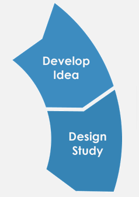

  <a href="/HOSS-LiU/" 
     style="display: inline-block; 
            padding: 10px 20px; 
            background-color: #006699; 
            color: white; 
            text-decoration: none; 
            border-radius: 6px; 
            font-weight: bold;">
    Home
  </a>

# HOSS Resources 

## Methodology-specific resources 
[Metascience Resources](https://hoss-liu.github.io/HOSS-LiU/metascience) - here you will find detailed information about how to read and interpret a **meta-analysis** and how to do one yourself

## Discipline-specific resources   
[Neuroscience Resources](https://hoss-liu.github.io/HOSS-LiU/neuroscience) - here you will find information about different neuroscience methods supported by HOSS and other national infrastructures we collaborate with. You will also find method specific information about relevant open and reproducible science practices.

## Statistics and programming  
[R Studio](https://hoss-liu.github.io/HOSS-LiU/rstudio) - resources for programming beginners.  

## Resources by project stage   
Open science practices can be implemented at all stages of the research process. Below, we aim to collect guidance for integrating open science practices within your typical research workflow at any chosen stage.  

  

  
  

    
Transparent practices at this stage include preregistration and registered reports.
  
    
 
      <a href="https://hoss-liu.github.io/HOSS-LiU/registeredrep">
        Registered Reports Resources
      </a>
    

  

